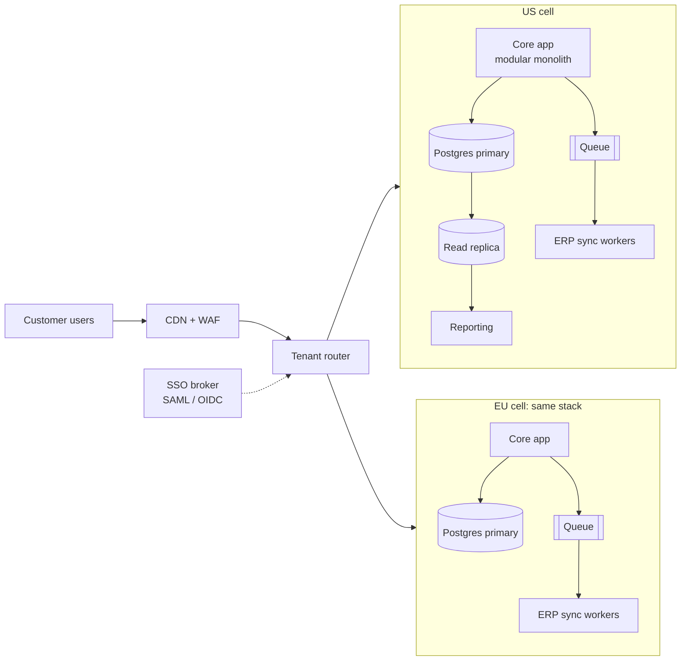

# Ledgerlight: technology strategy 2027

> **Fictional example.** Ledgerlight, its numbers and its people are invented to show how the [template](../template/one-pager.md) reads when filled in. They do not describe any real company.

**Author:** VP Engineering · **Date:** 2026-11-10 · **Status:** For decision · **Decision needed by:** 2026-12-05

## 1. Why now

Ledgerlight sells accounts-payable automation to mid-market finance teams. The 2027 plan is to move upmarket: win enterprise customers and enter the EU. Our platform blocks both. In 2026 we lost 6 enterprise deals that cited missing SSO, audit logs or EU data residency, and our infrastructure cost grows faster than revenue.

## 2. Current state

- **Architecture:** one Node.js/TypeScript monolith and one Postgres primary in a single AWS region. ERP sync and nightly reporting jobs run on the primary database.
- **Reliability:** 99.5% availability over the last 12 months. p95 API latency reaches 850 ms during month-end close, when customers' finance teams all work at once.
- **Delivery:** weekly deploys with a 2-hour freeze. 22% of deploys need a hotfix or rollback.
- **Cost:** $41K per month, up 40% in 12 months while customers grew 15%. Average CPU use across app servers is 18%.
- **Business limit:** no SSO, no customer-visible audit log, no EU hosting.

## 3. Target architecture

- **Cells, not a rewrite.** The EU cell is a copy of the US stack from the same infrastructure code. A tenant's data lives in exactly one cell, which gives residency without a new data model.
- **Take load off the primary.** Reporting moves to a read replica. ERP sync moves to a queue with autoscaled workers. This fixes month-end latency and lets us shrink the primary.
- **Modular monolith, not microservices.** We split the code into modules with enforced boundaries. Only ERP sync becomes a separate deployable, because it scales differently. With 28 engineers, more services would add operating cost before they add speed.
- **SSO and audit log** are platform features owned by one team, not built per product area.

## 4. Phased approach

| Quarter | Theme | Deliverables | Exit criteria |
|---|---|---|---|
| Q1 2027 | Foundations | Tracing and SLO dashboards; cost levers 1–4 (appendix C); read replica for reporting; CI quality gates | p95 < 500 ms at month-end; cost ≤ $30K/month |
| Q2 2027 | Enterprise features | SSO (SAML/OIDC); audit log; queue-based ERP sync; module boundaries enforced in CI | 2 enterprise pilots live on SSO; cost ≤ $26K/month |
| Q3 2027 | EU cell | Tenant router; EU cell from shared IaC; first EU tenants; DR test in both cells | 3 EU tenants live; restore test in each cell meets RPO ≤ 5 min and RTO ≤ 1 h |
| Q4 2027 | Scale and harden | Daily deploys; legacy batch jobs retired; per-tenant cost reporting | Targets in section 8 met |

## 5. Risks

| Risk | L / I | Mitigation | Owner |
|---|---|---|---|
| EU demand is lower than sales expects | M / H | EU cell build starts only after 3 signed EU letters of intent. Q1–Q2 work pays off without it | VP Eng + CRO |
| A second cell doubles operational load | H / M | One IaC codebase, identical cells, one on-call rotation; platform team staffed first | Platform lead |
| Cost savings erode as usage grows | M / M | Per-tenant cost dashboard; monthly review; commit discounts only on the right-sized baseline | Platform lead |
| Hiring slips | M / H | Hires ordered by dependency; contractor fallback for SSO; EU cell moves to Q4 if platform team is under 4 people by end of Q2 | VP Eng |
| Migration causes a customer-visible incident | M / H | Tenant-by-tenant moves behind a flag, internal tenants first, rollback tested before each wave | Platform lead |

## 6. Cost

| | Today | End Q2 2027 | End 2027 (with EU cell) |
|---|---|---|---|
| Infrastructure / month | $41.0K | $26.0K | $34.0K |
| Active customers (plan) | 410 | 440 | 520 |
| Cost per active customer / month | $100 | $59 | $65 |

The main lever is right-sizing: servers run at 18% CPU and the database is sized for nightly jobs that move to a replica. Commit discounts come after right-sizing, so we don't lock in waste. The $15K/month saved by Q2 more than pays for the EU cell, which adds about $7K/month (appendix C: $34K with it, $27K without). Full model in [appendix C](appendix.md#c-cost-model).

## 7. Team

28 engineers today in 4 product squads and a 2-person infrastructure group. We form a 5-person platform team that owns cells, SSO, audit and cost: the 2 infrastructure engineers, 1 internal move, and 2 hires (a staff platform engineer and an SRE). We also hire a senior backend engineer for ERP sync and, in Q3, an EU-based SRE so the EU cell has on-call cover in its own working hours. Net +4 hires, 32 engineers by end of 2027. Details and fallbacks in [appendix D](appendix.md#d-team-and-hiring-plan).

## 8. Success metrics

| Metric | Baseline (2026) | Target (end 2027) |
|---|---|---|
| Availability (monthly) | 99.5% | 99.9% |
| p95 API latency at month-end | 850 ms | < 300 ms |
| Deploy frequency | Weekly | Daily |
| Change failure rate | 22% | < 10% |
| Infrastructure cost per active customer | $100 / month | ≤ $66 / month |
| Enterprise deals lost to SSO, audit or residency gaps | 6 | 0 |

## 9. Decisions requested

1. Approve 4 engineering hires (staff platform engineer, SRE, senior backend engineer, EU-based SRE) per appendix D.
2. Approve a 1-year compute commitment of about $6K/month for the always-on baseline, signed after right-sizing in Q1.
3. Agree that EU cell work starts only after 3 signed EU letters of intent.
