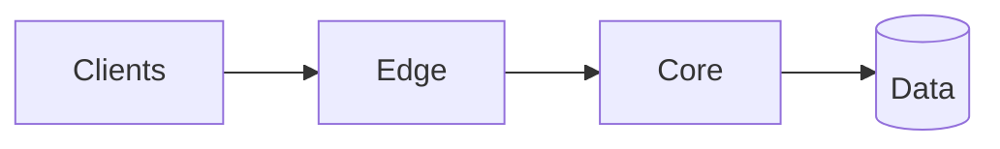

# [Company / product]: technology strategy [period]

**Author:** [name, role] · **Date:** [YYYY-MM-DD] · **Status:** Draft | For decision | Approved · **Decision needed by:** [date]

> Rules: one page. Every claim has a number or a source. Detail goes in the [appendix](appendix.md). If a section does not change a decision, cut it.

## 1. Why now

[Two or three sentences. The business goal this strategy serves, and what blocks it today. Write it so the CEO and the CFO would both agree with it.]

## 2. Current state

[Four to six bullets. Facts, not complaints. Include the numbers that matter: scale, reliability, delivery speed, cost, and the specific limits the business is hitting.]

- **Architecture:** [...]
- **Reliability:** [...]
- **Delivery:** [...]
- **Cost:** [...]
- **Business limit:** [...]

## 3. Target architecture

[One diagram and three to five bullets on what changes and why. Name what you are deliberately *not* doing.]

## 4. Phased approach

| Quarter | Theme | Deliverables | Exit criteria |
|---|---|---|---|
| [Q1] | [...] | [...] | [measurable] |
| [Q2] | [...] | [...] | [...] |
| [Q3] | [...] | [...] | [...] |
| [Q4] | [...] | [...] | [...] |

## 5. Risks

| Risk | Likelihood / impact | Mitigation | Owner |
|---|---|---|---|
| [...] | [H/M/L] / [H/M/L] | [...] | [...] |

## 6. Cost

| | Today | [Milestone 1] | [Milestone 2] |
|---|---|---|---|
| Infrastructure / month | [...] | [...] | [...] |
| Cost per [unit: customer, tenant, transaction] | [...] | [...] | [...] |

[One sentence on the main lever and why it is safe. Full model in the appendix. Monthly actuals come from the [FinOps review](../toolkit/finops-review.md).]

## 7. Team

[Current shape, changes, hires by quarter, and what happens if hiring slips. Use the [org design template](../toolkit/org-design.md) for the team-by-team view.]

## 8. Success metrics

[Outcome metrics the business recognises, plus delivery and reliability metrics. These become key results in the [operating model](../toolkit/operating-model.md).]

| Metric | Baseline | Target [date] |
|---|---|---|
| [...] | [...] | [...] |

## 9. Decisions requested

1. [Specific approval, with amount or headcount.]
2. [...]
