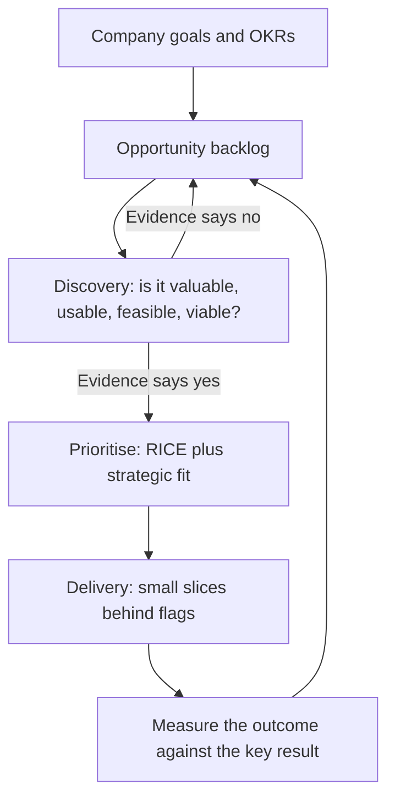

# Product engineering operating model

How a product and engineering organisation decides what to build, builds it, and checks that it worked. Use it to describe the model you run today, then change one part at a time. The strategy [one-pager](../template/one-pager.md) says *where* the platform is going; this page says *how* the organisation turns goals into shipped outcomes.

## The loop



Discovery and delivery run at the same time in every team. A team that only delivers builds whatever arrives; a team that only discovers ships nothing.

## Roles

| Role | Owns | Decides |
|---|---|---|
| Product manager | The problem, the outcome, and the evidence that it matters | What problem to solve next, and when it is solved |
| Engineering manager | Team health, delivery, hiring and growth | How the team works and who works on what |
| Tech lead | Technical design and quality | How it is built, and what technical work is needed |
| Designer | Usability and the user's experience | How the user does it |

Product manager, tech lead and designer form the **product trio**. They do discovery together. Engineers who only see a finished spec cannot suggest the cheaper solution they would have spotted in discovery.

## Goals: OKRs that work

- **Objectives are outcomes for customers or the business,** not projects. "Finance teams close the month without waiting on us" rather than "build the reporting replica".
- **Two to four key results per objective,** each a number with a baseline: "p95 latency at month-end from 850 ms to under 300 ms".
- **Team OKRs link to one company objective.** If a team cannot link its work to one, ask whether the work should happen.
- **Leave room for keeping the lights on.** Reserve a stated share of capacity for operations, support and tech debt (commonly 20–30%) outside the OKRs, so OKRs do not quietly absorb it.
- **Score at the end of the quarter, 0.0–1.0.** Consistent 1.0 means the targets were too safe. Do not tie OKR scores to individual pay.

### OKR template

| Objective | Key result | Baseline | Target | Owner | Score |
|---|---|---|---|---|---|
| | | | | | |

## Discovery: evidence before build

Answer the four risks before committing a team for more than a few weeks:

| Risk | Question | Cheap ways to test it |
|---|---|---|
| Value | Will customers choose to use it? | Customer interviews, fake-door test, pilot with design partners |
| Usability | Can they figure out how? | Prototype tests with 5 users |
| Feasibility | Can we build and run it with the team and time we have? | Spike, architecture review, a written RFC for cross-team changes |
| Viability | Does it work for the business: sales, legal, support, cost? | Review with the affected functions; unit cost estimate |

Write the result as a one-page opportunity brief: problem, evidence, who has it, expected outcome, the riskiest assumption and how you tested it.

## Prioritisation: RICE

[RICE](https://www.intercom.com/blog/rice-simple-prioritization-for-product-managers) (from Intercom) turns a long list into a ranked one, so the debate is about inputs you can check instead of opinions.

```text
RICE score = Reach × Impact × Confidence ÷ Effort
```

| Factor | Meaning | Scale |
|---|---|---|
| Reach | Customers or events affected per quarter | A count, from data |
| Impact | Effect on the key result for each one reached | 3 = massive, 2 = high, 1 = medium, 0.5 = low, 0.25 = minimal |
| Confidence | How sure you are of reach and impact | 100% = data, 80% = some evidence, 50% = a guess |
| Effort | Team-months to deliver | A number; round up |

### Worked example (fictional)

| Opportunity | Reach / qtr | Impact | Confidence | Effort | RICE |
|---|---|---|---|---|---|
| SSO for enterprise accounts | 40 accounts | 3 | 80% | 4 | 24 |
| Bulk invoice approval | 300 accounts | 1 | 80% | 2 | 120 |
| Dark mode | 400 accounts | 0.25 | 50% | 1 | 50 |

Bulk approval ranks first by score. SSO ranks last, but it unblocks the enterprise objective and has a sales deadline. That is a legitimate override: **RICE ranks; leaders decide, and write down why they overrode the score.** Overrides that happen every quarter mean the scoring inputs are wrong.

## Delivery

- **Small slices.** Each slice ships to production behind a flag and can be shown to a customer. Aim for days, not weeks.
- **Done means in users' hands** and measured against the key result, not merged.
- **Measure the system.** Track DORA metrics (deployment frequency, lead time, change failure rate, recovery time) per team, next to the outcome metrics. Speed without outcomes is output; outcomes without speed do not compound.

## Cadence

| Rhythm | Meeting | Output |
|---|---|---|
| Weekly | Team planning and demo | Next slices; what shipped and what it did |
| Every 2 weeks | Product and engineering leads review | Risks, cross-team dependencies, capacity moves |
| Monthly | Business review | OKR progress, DORA and reliability trends, cost per unit |
| Quarterly | Planning | OKRs set and scored; capacity split agreed; strategy one-pager revisited |

## Signs the model is healthy

- Each team can say which company objective its current work serves.
- Discovery kills some ideas. If nothing is ever rejected, discovery is a formality.
- Key results move after delivery, and the team checks whether they did.
- Engineers join customer conversations at least once a quarter.
